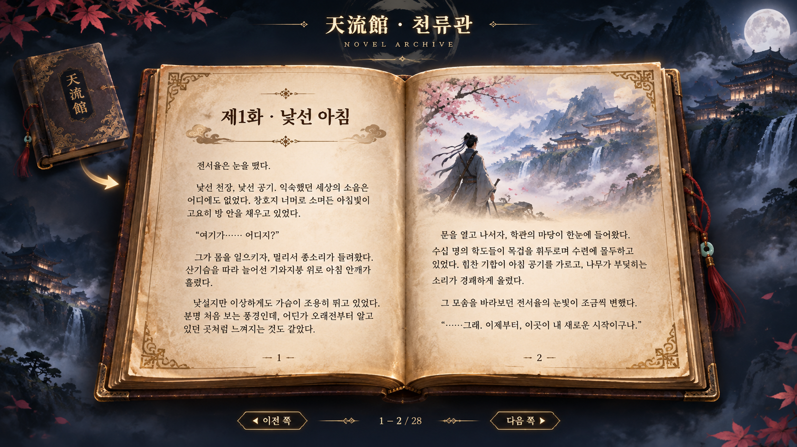

# 천류관 고서형 리더 — 목표 디자인 시안 v0.6.3

## 시안의 역할
이 이미지는 **목표 디자인 레퍼런스**입니다. 실제 웹 리더 화면이나 완성된 UI 구현 결과가 아닙니다. 이미지에 보이는 문장은 디자인을 설명하기 위한 **예시**이며 실제 NOVEL 원고에 반영하지 않습니다.

## 목표 UX
1. 리더 진입 시 전체 화면에 고서 표지 표시, 펼치기 동작 후 좌우 2쪽 배치.
2. 한 화면에 책을 가능한 크게 배치하고 외부 세로 스크롤을 없앰.
3. 회차의 실제 `cover` 이미지가 있을 때만 펼침 순간 흐릿하게 나타나고 자연스럽게 사라짐.
4. 핵심 사건 삽화는 마크다운에서 지정된 실제 이미지만 해당 페이지에 표시.
5. 페이지 넘김은 좌우 방향키, 버튼, 터치에 대응하고 `prefers-reduced-motion`을 존중.
6. 모바일에서는 글자 크기와 페이지 레이아웃을 읽기 좋게 최적화.
7. 배경은 남색 산수화, 책은 낡은 가죽·금박·황갈색 한지 질감, 장식은 절제된 금색.
8. 소설 본문은 실제 `min-ser/NOVEL` 동기화 데이터만 표시. 가짜 원고·이미지 대체 금지.

## 구현과 시안의 구분
- v0.6.2: 책 표지·2쪽 리더·페이지 분할·회차 이미지 연출의 기본 기능 구현.
- v0.6.3: 목표 디자인 이미지와 상세 가이드를 프로젝트에 추가. **이미지 속 장식 및 레이아웃을 코드로 완전히 구현한 것은 아님**.
- 다음 단계: 실제 리더 CSS/HTML을 시안에 가깝게 조정하고 PC·모바일 검수.

## 리소스 위치
- 설계 원본: `docs/design/novel-reader-target-v0.6.3.png`
- 사이트 정적 자산: `static/assets/design/novel-reader-target-v0.6.3.png`
